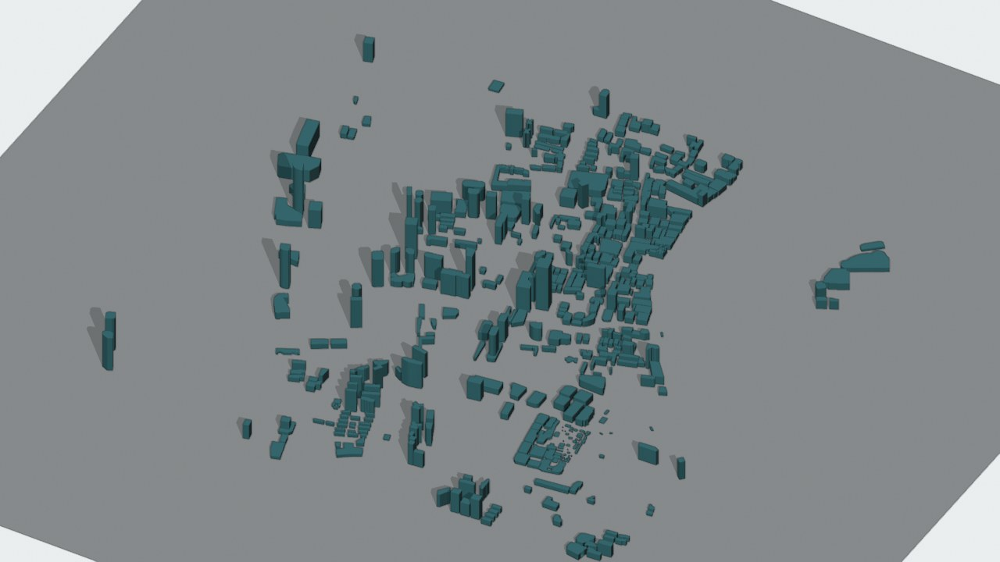

# Shanghai City Twin

从开放地图到可追溯 3D 场景的开发者流水线。上海是第一个真实数据样例。

[English](README.en.md) · [Apache-2.0](LICENSE) · [地图数据许可](DATA_LICENSE.md) · [贡献指南](CONTRIBUTING.md)



画面为实际 OBJ 渲染，不是 Unreal 或 MotrixSim 运行录像。数据来自 OpenStreetMap contributors，遵循 ODbL。建筑高度包含楼层估算；展示底板不是实测地形。

## 下载与演示

- [v0.1.0-alpha.1 预发布版](https://github.com/eust-w/shanghai-city-digital-twin-plan/releases/tag/v0.1.0-alpha.1)：真实样例资产、横竖版介绍视频、字幕、制作记录和 SHA256 校验清单。
- [观看 44 秒介绍视频](https://www.douyin.com/video/7700918059808181504) · [X 发布帖](https://x.com/eustancewu/status/2114660223210430712)。横版主片约 83 秒，可从 Release 下载。
- [发布与验证记录](docs/07-release-record.md)：23 项单元测试，以及 Python 3.9 / 3.12 / 3.14 上的真实存档导出 CI。

核心原则：

- Google Maps / Google Earth 适合作为在线视觉参考或流式可视化底图，不作为可离线导出、可编辑、可再发布的城市资产来源。
- 可控、可仿真、可商业化的城市模型必须来自开放数据、采购授权数据或自采合规数据，并保留数据来源、许可证和更新时间。
- 城市重建应拆成视觉层、GIS 数据层、资产生成层、仿真语义层、引擎运行层，而不是把一张地图直接“导出成城市”。

## 文档

- [需求说明](docs/01-requirements.md)
- [实施方案](docs/02-implementation-plan.md)
- [POC 运行手册](docs/03-poc-runbook.md)
- [运行资产说明](docs/04-runtime-artifacts.md)
- [开源发布评估](docs/05-open-source-release.md)
- [介绍视频与平台文案](docs/06-launch-campaign.md)
- [发布与验证记录](docs/07-release-record.md)

## 项目目标

构建一套真实可落地的上海城市重建方案，支持以下方向：

- 游戏引擎中的大范围城市场景。
- 城市数字孪生可视化。
- 交通、车辆、机器人或城市运营仿真。
- 分级精度建模：全市低精度覆盖 + 重点区域高精度还原。

## 当前状态

当前仓库包含：

- 需求和实施方案。
- 一个可执行的真实开放数据 POC 流水线。
- PostGIS SQL、glTF、3D Tiles preview、SUMO、OpenDRIVE 和 Web 查看器导出。
- Unreal Engine 导入候选包：`.uproject`、OBJ 建筑体块、导入脚本和关卡生成脚本，尚未完成 Unreal Editor 原生验收。
- 面向 MotrixSim 的场景候选包：`scene.xml`、`scene.urdf`、`scene.json`、视觉 OBJ、碰撞 OBJ 和 ZIP 包，包校验不等于 MotrixSim 原生验收。
- 默认 POC 配置：`config/poc-shanghai-core.json`。

当前是 early preview / POC，不是完整城市复刻或经过物理验收的仿真地图。2026-06-08 样本有 2,227 个建筑轮廓；导出 573 栋体块，其中 13 栋来自 OSM 高度标签、560 栋按楼层数乘配置层高估算，另外 1,654 栋缺少高度而跳过。地图高度标签不等于本项目实测高度。

Motrix 候选包当前缩放为原尺寸的 `0.40424188`，碰撞网格合并与复杂多边形处理仍有限制。详见[开源发布评估](docs/05-open-source-release.md)。自有代码采用 Apache-2.0；OSM 数据另遵循 [ODbL 与署名要求](DATA_LICENSE.md)。

仓库不包含密钥、Google 离线地图数据、第三方商业素材或生成后的大体量数据。运行输出默认写入 `data/`，该目录不纳入版本控制。

## 快速运行

先用仓库内真实存档样例离线复现，无需 API 密钥或第三方 Python 依赖：

```bash
python3 scripts/run_archived_example.py --output artifacts/example
```

该样例的数据时间为 2026-06-08，不代表当前地图。随后可运行测试并从网络抓取最新数据：

```bash
python3 -m unittest discover -s tests
python3 -m city_twin_pipeline run-poc \
  --config config/poc-shanghai-core.json \
  --output data/poc-shanghai-core \
  --fail-on-quality
```

该命令会从 Overpass API 拉取真实 OpenStreetMap 数据，并导出建筑、道路、水系、绿地、POI GeoJSON、质量报告、数据台账、PostGIS SQL、glTF、3D Tiles preview、SUMO、OpenDRIVE、本地 Web 查看器及引擎导入候选包。不会使用 mock 数据，也不会把 Google Maps / Google Earth / Google 3D Tiles 作为离线资产来源。数据质量检查通过不表示所有目标引擎已经运行验收。

当 Overpass 网络不稳定时，可以使用已真实拉取的原始数据继续导出：

```bash
python3 -m city_twin_pipeline run-poc \
  --config config/poc-shanghai-core.json \
  --raw-input data/poc-shanghai-core/raw/osm_overpass.json \
  --output data/poc-shanghai-core \
  --fail-on-quality
```

查看器：

```bash
cd data/poc-shanghai-core
python3 -m http.server 8765
```

打开 `http://localhost:8765/viewer/index.html`。

Unreal 导入包位于 `data/poc-shanghai-core/unreal/`，压缩包为 `data/poc-shanghai-core/ShanghaiCityTwinPOC_UnrealImportPackage.zip`。有 Unreal Editor 的机器可执行：

```bash
/path/to/UnrealEditor data/poc-shanghai-core/unreal/ShanghaiCityTwinPOC.uproject \
  -ExecutePythonScript=data/poc-shanghai-core/unreal/Scripts/import_city_twin_scene.py
```

Motrix 候选包位于 `data/poc-shanghai-core/motrix_scene/`，压缩包为 `data/poc-shanghai-core/motrix_scene.zip`。`scene.xml` 为 MJCF，`scene.urdf` 为 URDF，`scene.json` 为本项目的场景索引；具体版本的 MotrixSim 是否接受这些入口，需要按其文档实测，不能由文件扩展名推断。历史 MuJoCo 加载记录也不代替 MotrixSim 验收。
